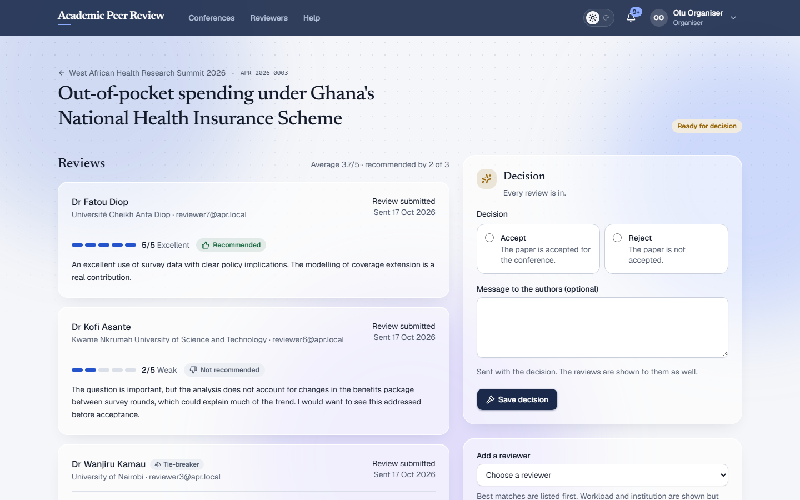
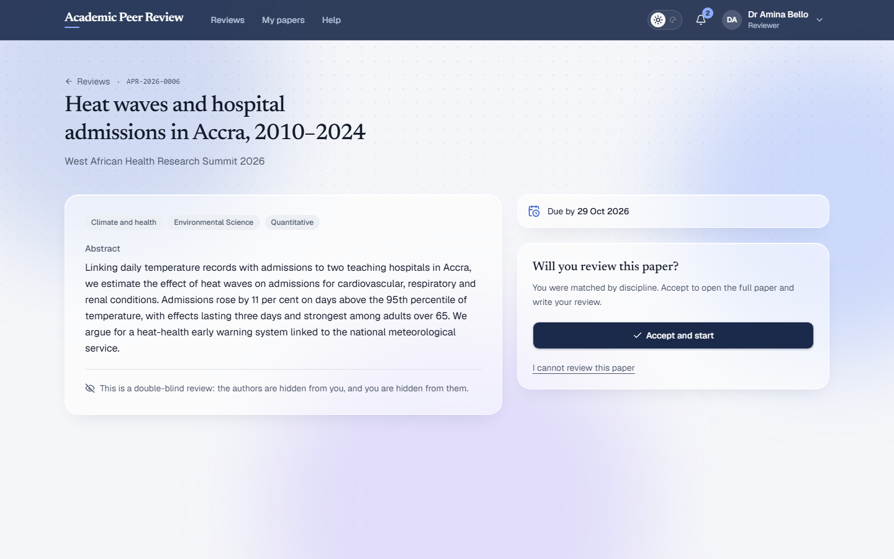

# Academic Peer Review

[](https://github.com/Lisky-pixel/Academic-Peer-Review/actions/workflows/ci.yml)


Peer review for academic conferences. Organisers open a call for papers,
authors submit, papers are matched automatically to reviewers in the right
discipline, reviewers score and comment, and organisers decide, with every
author hearing back.



## Features

**For organisers**

- A dashboard per conference: papers by stage, filters and search, reviewer
  progress, reports by topic, discipline and type, and the acceptance rate.
- Automatic reviewer matching when the call closes, or on demand.
- Reviews side by side with scores and recommendations; accept or reject with
  a message to the authors.
- Excel exports of every paper and every review.

**For authors**

- Submit to any open call: title, authors, institution, topic, discipline,
  paper type, abstract and the full paper (PDF or Word).
- Edit until reviewers have the paper; follow its progress.
- Read every review and download marked-up copies once a decision is made.

**For reviewers**

- Sign up with disciplines, rank and experience; add a CV.
- Papers arrive by email, matched to their field and never from their own
  institution. Decline, or declare a conflict of interest, and the paper goes
  to someone else at once.
- Score from 1 to 5, recommend or not, comment, and return a marked-up copy.
- Reminders 7, 3 and 1 days before a review is due.

**Throughout**

- Reviewers are anonymous to authors in the interface, in emails and inside
  downloaded files; conferences can also hide authors from reviewers.
- When reviewers disagree, a tie-breaker reviewer is added automatically.
- Light and dark themes, built for phones as well as laptops, and checked for
  accessibility (WCAG 2.1 AA) on every page.

<table>
  <tr>
    <td></td>
    <td></td>
  </tr>
  <tr>
    <td></td>
    <td></td>
  </tr>
</table>

## How it works

```
Author submits ──▶ call closes ──▶ matched to reviewers by discipline
                                            │
                       reviewers score 1–5, recommend, comment
                                            │
                     disagree? ──▶ a tie-breaker reviewer is added
                                            │
Author reads every review ◀── organiser accepts or rejects
```

To put it on the internet, follow [docs/DEPLOY.md](docs/DEPLOY.md).

## Stack

| Layer    | Development                                | Production    |
| -------- | ------------------------------------------ | ------------- |
| App      | Next.js 16 (App Router), TypeScript        | same, Vercel  |
| UI       | Tailwind 4, shadcn/ui, lucide icons        | same          |
| Database | Postgres 17 (Docker), Prisma 7             | Neon          |
| Storage  | MinIO (S3 API)                             | Cloudflare R2 |
| Email    | Mailpit (catches everything)               | Resend        |
| Auth     | Own sessions (argon2id + httpOnly cookies) | same          |

Storage and email sit behind interfaces (`lib/storage`, `lib/email`), so the only
difference between the two columns is environment variables.

## Getting started

Requires Node 20+, pnpm, and Docker Desktop.

```bash
pnpm install
cp .env.example .env.local     # the defaults already target the Docker stack
pnpm docker:up                 # Postgres + MinIO + Mailpit
pnpm db:reset                  # migrate + seed
pnpm dev
```

| Service        | URL                                                        |
| -------------- | ---------------------------------------------------------- |
| App            | http://localhost:3000                                      |
| Mailpit inbox  | http://localhost:8025                                      |
| MinIO console  | http://localhost:9001 (`reviewflow` / `reviewflow-secret`) |
| Email previews | http://localhost:3000/dev/emails                           |
| Prisma Studio  | `pnpm db:studio`                                           |

No email leaves your machine in development; Mailpit catches all of it.

Seeded accounts, all with the password `Password123!`, at `@apr.local`:

| Role          | Email                                               |
| ------------- | --------------------------------------------------- |
| Administrator | `admin@apr.local`                                   |
| Organiser     | `organiser@apr.local`                               |
| Reviewer      | `reviewer1@` … `reviewer8@` (different disciplines) |
| Submitter     | `user1@`, `user2@`, `user3@`                        |

The seed also creates two demo conferences with papers at every stage: under
review, waiting for a tie-breaker, ready for a decision, accepted and rejected.

**Restart `pnpm dev` after any database migration.** The running server caches
the database client and will fail on new columns until restarted.

## Commands

```bash
pnpm dev                 # development server
pnpm build               # production build
pnpm typecheck           # TypeScript
pnpm lint                # ESLint
pnpm format              # Prettier

pnpm test                # unit and database tests (Vitest)
pnpm test:e2e            # browser tests (Playwright); needs the stack up and seeded

pnpm db:migrate          # create and apply a migration in development
pnpm db:deploy           # apply migrations (production)
pnpm db:seed             # disciplines, development accounts and demo conferences
pnpm db:seed:reference   # disciplines only; safe for production
pnpm db:seed:demo        # demo conferences on a live site (needs DEMO_PASSWORD)
pnpm db:reset            # drop, migrate, seed
pnpm admin:create --email you@example.com --name "Your Name"
                         # the first administrator of a fresh deployment
```

The first run of the browser tests needs `pnpm exec playwright install chromium`.

## How it is put together

```
app/                 pages, route handlers and server actions, by role
  (auth)/            sign in, sign up (submitter or reviewer), reset, invite, verify
  (user)/            a submitter's papers
  (reviewer)/        a reviewer's queue and review page
  (organiser)/       conferences, papers, reviewers, reports, export
  (admin)/           conferences, organisers, payments, people, activity
  (account)/         profile, reviewer details and CV, shared by every role
  help/              questions and the contact form
  api/cron/          the daily job
lib/
  auth/              sessions, passwords, guards, invites, registration
  workflow/          the paper state machine
  matching/          choosing reviewers, tie-breakers
  submissions/ reviews/ conferences/    one folder per side
  dto/               what each audience is allowed to see
  files/             upload validation and metadata scrubbing
  storage/ email/    providers, behind interfaces
  notifications/     in-app and email notices, and all their wording
  maintenance/       matching after the call closes, reminders, clean-up
proxy.ts             route protection and the Content Security Policy
prisma/              schema, migrations, seed
e2e/                 browser tests
```

### The state machine

A paper's status is changed in exactly one place: `transition()` in
[lib/workflow/state-machine.ts](lib/workflow/state-machine.ts). In one database
transaction it checks the move is legal for that person, updates the status,
writes the activity log, and queues notifications. The table of legal moves is
[lib/workflow/transitions.ts](lib/workflow/transitions.ts).

| From                              | Event            | To                    | Who                               |
| --------------------------------- | ---------------- | --------------------- | --------------------------------- |
| `DRAFT`                           | submit           | `SUBMITTED`           | submitter                         |
| `SUBMITTED`                       | start review     | `UNDER_REVIEW`        | system or organiser, on matching  |
| `UNDER_REVIEW`                    | complete reviews | `REVIEWS_COMPLETE`    | the last reviewer, or system      |
| `REVIEWS_COMPLETE`                | reopen reviews   | `UNDER_REVIEW`        | organiser adds a reviewer         |
| `UNDER_REVIEW`/`REVIEWS_COMPLETE` | accept / reject  | `ACCEPTED`/`REJECTED` | organiser                         |
| `DRAFT`/`SUBMITTED`               | withdraw         | `WITHDRAWN`           | submitter (organiser at any time) |

Submitters see a simpler stage ([lib/submissions/stage.ts](lib/submissions/stage.ts)):
"reviews complete" still reads as "under review" until the decision.

### Anonymity

Three independent layers, so that one failing does not leak an identity.

1. **What each audience can be given** is fixed by types in `lib/dto/`. The
   submitter-facing shapes have no field that could hold a reviewer's name;
   reviews are labelled "Reviewer 1, 2, 3".
2. **File bytes.** [lib/files/scrub.ts](lib/files/scrub.ts) removes names from
   Word and PDF metadata: document properties, the author of every tracked
   change, comment and annotation. Papers are scrubbed on upload, marked-up
   copies before anyone sees them.
3. **Messages.** All notification wording is in
   [lib/notifications/messages.ts](lib/notifications/messages.ts). The functions
   that write to submitters take only a reference and a title.

Whether reviewers see the authors is the conference's double-blind setting,
resolved only in `toReviewerPaperDTO()`.

### Security

- Sessions are random tokens in an httpOnly, SameSite=Lax cookie; only their
  SHA-256 is stored. Passwords are argon2id.
- Every protected page and action starts with a guard from
  [lib/auth/guards.ts](lib/auth/guards.ts) that checks the database.
- [proxy.ts](proxy.ts) sets a Content Security Policy with a per-request nonce;
  other security headers are in [next.config.ts](next.config.ts).
- Cross-site request forgery: mutations are server actions, which Next.js only
  accepts when the request's origin matches the site, and the session cookie is
  not sent on cross-site POSTs.
- Uploads go straight to storage through short-lived signed URLs, and are
  checked by their real bytes before being recorded.
- Sign-in, registration and reset are rate limited, and answer the same way
  whether or not an email is registered.

## Testing

`pnpm test` runs the unit tests and the database tests (`*.db.test.ts`), which
use the real Postgres and MinIO from Docker and skip, with a warning, if those
are not running. They clean up the accounts they create.

`lib/workflow/flow.db.test.ts` runs a paper through the whole journey against
the real database: submit, match, a conflict of interest, disagreement, a
tie-breaker, the decision, and the anonymous reviews. `pnpm test:e2e` checks
accessibility in both themes and the Content Security Policy on every page.

Working notes for whoever, or whatever, picks the code up next are in
[CLAUDE.md](CLAUDE.md).

## License

Proprietary. All rights reserved.
